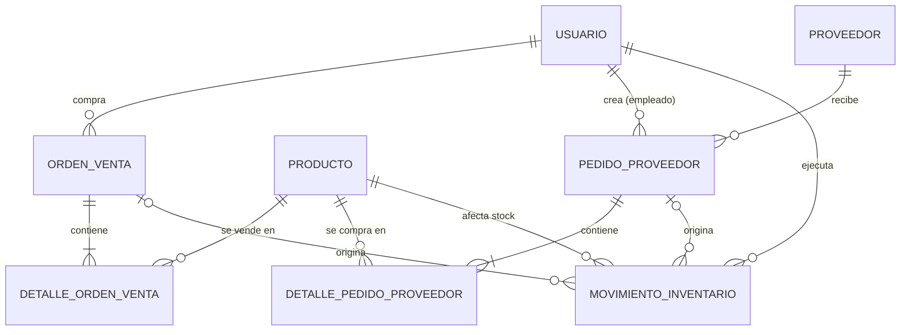

# Modelo de datos y entidades (MVP)

Guía de referencia para el proyecto Spring Boot + Hibernate. Asume el esquema `schema_mvp.sql` (MySQL 8.0.16+, 8 tablas).

---

## 1. Visión general



| Entidad Java | Tabla | Qué representa |
|---|---|---|
| `Usuario` | `usuario` | Persona que se autentica: cliente, empleado o administrador |
| `Proveedor` | `proveedor` | Quien surte la mercancía (independiente de `usuario`) |
| `Producto` | `producto` | Artículo que se compra y se vende |
| `OrdenVenta` | `orden_venta` | Compra hecha por un usuario |
| `DetalleOrdenVenta` | `detalle_orden_venta` | Línea de una orden de venta |
| `PedidoProveedor` | `pedido_proveedor` | Pedido de mercancía a un proveedor |
| `DetallePedidoProveedor` | `detalle_pedido_proveedor` | Línea de un pedido a proveedor |
| `MovimientoInventario` | `movimiento_inventario` | Libro de entradas y salidas: única fuente del stock |

---

## 2. Reglas globales

1. **La base de datos la crea el script, no Hibernate.** Hibernate solo mapea y consulta.
2. **Nada se borra.** Se usa `activo` (usuario, proveedor, producto) o `estado` (órdenes, pedidos). No uses `deleteById` ni `cascade = REMOVE`.
3. **El stock no es un campo.** Es `SUM(movimiento_inventario.cantidad)` por producto. Entra `+N`, sale `-N`.
4. **Los totales no son campos.** Se calculan con `SUM(subtotal)` de los detalles.
5. **El precio se congela** en el detalle al momento de la compra. Cambiar `producto.precio_venta` no afecta órdenes pasadas.
6. **Cada documento guarda el usuario que lo creó** (`orden_venta.id_usuario`, `pedido_proveedor.id_usuario`, `movimiento_inventario.id_usuario`).
7. **Todas las FK son `LAZY`** (`@ManyToOne(fetch = FetchType.LAZY)`). Para listados usa `join fetch` o `@EntityGraph`.
8. **Dinero siempre `BigDecimal`**, con `precision = 12, scale = 2`.
9. **No expongas entidades en la API.** Usa DTOs; así nunca se filtra `passwordHash` ni se rompen las relaciones lazy.

---

## 3. Puesta en marcha

**Base de datos:** ejecuta `schema_mvp.sql` completo en MySQL Workbench (Query → Execute All) contra el contenedor MySQL 8.0 (por ejemplo `docker run -e MYSQL_DATABASE=tienda -e MYSQL_ROOT_PASSWORD=... -p 3306:3306 -d mysql:8.0 --character-set-server=utf8mb4`).

**`application.properties`:**

```properties
spring.jpa.hibernate.ddl-auto=validate
spring.jpa.open-in-view=false
spring.jpa.properties.hibernate.jdbc.time_zone=UTC
```

> ⚠️ **Nunca uses `create`, `create-drop` ni `update`.** `create` y `create-drop` borran las tablas del script (con sus `CHECK`, columnas generadas e índices). Si `validate` se queja por diferencias menores de tipos (`TEXT`, `BOOLEAN`), ajusta la anotación de ese campo; si se vuelve ruidoso, usa `ddl-auto=none`.

---

## 4. Enums

Todos se guardan como texto (`@Enumerated(EnumType.STRING)`) y deben coincidir con los `CHECK` de la base.

| Enum | Valores | Columna |
|---|---|---|
| `Rol` | `CLIENTE`, `EMPLEADO`, `ADMINISTRADOR` | `usuario.rol` |
| `EstadoOrden` | `PENDIENTE`, `ENTREGADA`, `CANCELADA` | `orden_venta.estado` |
| `EstadoPedido` | `PENDIENTE`, `RECIBIDO`, `CANCELADO` | `pedido_proveedor.estado` |
| `TipoMovimiento` | `ENTRADA_COMPRA`, `SALIDA_VENTA`, `ANULACION_VENTA`, `AJUSTE` | `movimiento_inventario.tipo_movimiento` |

> ⚠️ **Los valores en la base están en minúsculas** (`'cliente'`, `'pendiente'`, `'entrada_compra'`…). Si tus enums en Java van en mayúsculas, hay que convertirlos con un `AttributeConverter` o declarar los valores en minúsculas. Decídelo desde el primer enum para que los `CHECK` no rechacen los inserts.

Mapeo recomendado si `validate` espera un `ENUM` nativo de MySQL:

```java
@Enumerated(EnumType.STRING)
@JdbcTypeCode(SqlTypes.VARCHAR)
private EstadoOrden estado = EstadoOrden.PENDIENTE;
```

---

## 5. Entidades

### 5.1 `Usuario`

Persona que se autentica. Reemplaza a persona, cliente, empleado y rol del diseño anterior.

| Campo Java | Tipo | Columna | Notas |
|---|---|---|---|
| `id` | `Integer` | `id_usuario` | `IDENTITY` |
| `nombre` | `String` | `nombre` | obligatorio, máx. 120 |
| `correo` | `String` | `correo` | **único**, obligatorio, login |
| `passwordHash` | `String` | `password_hash` | BCrypt; nunca va en un DTO |
| `rol` | `Rol` | `rol` | por defecto `CLIENTE` |
| `documento` | `String` | `documento` | opcional, **único** |
| `telefono` | `String` | `telefono` | opcional |
| `direccion` | `String` | `direccion` | opcional |
| `activo` | `Boolean` | `activo` | por defecto `true` |
| `fechaCreacion` | `LocalDateTime` | `fecha_creacion` | se asigna al crear |
| `ultimoAcceso` | `LocalDateTime` | `ultimo_acceso` | opcional |

**Reglas**
- El correo se guarda en **minúsculas y sin espacios** (también al buscarlo en el login).
- El registro público **siempre** crea `rol = CLIENTE`. El request no puede traer el rol.
- Solo un `ADMINISTRADOR` puede cambiar el rol de otro usuario o crear empleados.
- **`documento` vacío se guarda como `null`, nunca como `""`**: la columna es `UNIQUE` y dos cadenas vacías chocarían.
- Un usuario con `activo = false` no puede iniciar sesión.
- Se desactiva, no se borra.

```java
@Entity @Table(name = "usuario")
public class Usuario {
    @Id @GeneratedValue(strategy = GenerationType.IDENTITY)
    @Column(name = "id_usuario") private Integer id;
    @Column(nullable = false, length = 100, unique = true) private String correo;
    @Column(name = "password_hash", nullable = false) private String passwordHash;
    @Enumerated(EnumType.STRING) @Column(nullable = false)
    private Rol rol = Rol.CLIENTE;
    @Column(nullable = false) private Boolean activo = true;
    @Column(name = "fecha_creacion", nullable = false, updatable = false)
    private LocalDateTime fechaCreacion = LocalDateTime.now();
    // resto de campos...
}
```

---

### 5.2 `Proveedor`

| Campo Java | Tipo | Columna | Notas |
|---|---|---|---|
| `id` | `Integer` | `id_proveedor` | `IDENTITY` |
| `nombre` | `String` | `nombre` | obligatorio |
| `documento` | `String` | `documento` | **único**, obligatorio (NIT o cédula) |
| `contacto` | `String` | `contacto` | opcional |
| `telefono` | `String` | `telefono` | opcional |
| `correo` | `String` | `correo` | opcional |
| `activo` | `Boolean` | `activo` | por defecto `true` |

**Reglas:** lo gestionan `EMPLEADO` y `ADMINISTRADOR`. No se puede crear un pedido a un proveedor inactivo.

---

### 5.3 `Producto`

| Campo Java | Tipo | Columna | Notas |
|---|---|---|---|
| `id` | `Integer` | `id_producto` | `IDENTITY` |
| `codigo` | `String` | `codigo` | **único**, máx. 30 |
| `nombre` | `String` | `nombre` | obligatorio |
| `descripcion` | `String` | `descripcion` | `TEXT`, opcional |
| `precioVenta` | `BigDecimal` | `precio_venta` | `>= 0` |
| `activo` | `Boolean` | `activo` | por defecto `true` |

**Reglas**
- No se puede vender un producto inactivo (la base no lo impide; lo valida el servicio).
- El stock **no** vive aquí: se consulta aparte (ver sección 7).
- Mapea `descripcion` con `@Column(columnDefinition = "TEXT")`. Si `validate` protesta, usa `@JdbcTypeCode(SqlTypes.LONGVARCHAR)`.

---

### 5.4 `OrdenVenta`

| Campo Java | Tipo | Columna | Notas |
|---|---|---|---|
| `id` | `Integer` | `id_orden_venta` | `IDENTITY` |
| `usuario` | `Usuario` | `id_usuario` | `@ManyToOne(LAZY)`; quien compra |
| `fechaOrden` | `LocalDateTime` | `fecha_orden` | se asigna al crear |
| `estado` | `EstadoOrden` | `estado` | por defecto `PENDIENTE` |
| `detalles` | `List<DetalleOrdenVenta>` | — | `@OneToMany(mappedBy = "orden", cascade = PERSIST)` |

**Estados:** `PENDIENTE` (creada, stock ya descontado) → `ENTREGADA` | `CANCELADA`. `CANCELADA` es final.

**Reglas**
- Crea la orden cualquier usuario autenticado (un empleado también puede comprar).
- Marcar `ENTREGADA`: `EMPLEADO` o `ADMINISTRADOR`.
- Cancelar: el dueño de la orden o un `EMPLEADO`/`ADMINISTRADOR`. Genera movimientos `ANULACION_VENTA` que reponen el stock.
- **Pendiente de decidir:** si se permite cancelar una orden ya `ENTREGADA` (equivale a una devolución). El esquema lo soporta.
- El **total** no es un campo: se calcula con `SUM(subtotal)` de sus detalles.

---

### 5.5 `DetalleOrdenVenta`

| Campo Java | Tipo | Columna | Notas |
|---|---|---|---|
| `id` | `Integer` | `id_detalle_orden_venta` | `IDENTITY` |
| `orden` | `OrdenVenta` | `id_orden_venta` | `@ManyToOne(LAZY)` |
| `producto` | `Producto` | `id_producto` | `@ManyToOne(LAZY)` |
| `cantidad` | `Integer` | `cantidad` | `> 0` |
| `precioUnitario` | `BigDecimal` | `precio_unitario` | copia de `producto.precioVenta` |
| `descuento` | `BigDecimal` | `descuento` | valor en pesos; por defecto `0` |
| `subtotal` | `BigDecimal` | `subtotal` | **columna generada: solo lectura** |

**Reglas**
- `precioUnitario` lo pone **el servidor** tomando el precio actual del producto. Nunca confíes en el precio que envíe el cliente.
- **Un producto aparece una sola vez por orden** (`UNIQUE`). Si el cliente envía el mismo producto dos veces, suma las cantidades o rechaza la petición.
- Un detalle no se edita después de creado: se cancela la orden.
- `descuento` no puede superar `cantidad × precioUnitario` (la base solo exige `>= 0`; el resto lo valida el servicio).

```java
@Column(insertable = false, updatable = false)
private BigDecimal subtotal;   // lo calcula MySQL; Hibernate no lo envía
```

> Si necesitas el `subtotal` justo después de guardar, haz `entityManager.refresh(detalle)` o anótalo con `@Generated` (la forma exacta depende de tu versión de Hibernate).

---

### 5.6 `PedidoProveedor`

| Campo Java | Tipo | Columna | Notas |
|---|---|---|---|
| `id` | `Integer` | `id_pedido_proveedor` | `IDENTITY` |
| `proveedor` | `Proveedor` | `id_proveedor` | `@ManyToOne(LAZY)` |
| `usuario` | `Usuario` | `id_usuario` | empleado que crea el pedido |
| `fechaPedido` | `LocalDateTime` | `fecha_pedido` | se asigna al crear |
| `estado` | `EstadoPedido` | `estado` | por defecto `PENDIENTE` |
| `detalles` | `List<DetallePedidoProveedor>` | — | `@OneToMany(mappedBy = "pedido", cascade = PERSIST)` |

**Estados:** `PENDIENTE` → `RECIBIDO` | `CANCELADO`.

**Reglas**
- Solo `EMPLEADO` y `ADMINISTRADOR` crean pedidos.
- **Recibir** = crear un movimiento `ENTRADA_COMPRA` por cada línea y pasar el pedido a `RECIBIDO`, todo en una transacción.
- Cancelar solo si está `PENDIENTE` y no tiene entradas.
- Quién recibe y cuándo queda en `movimiento_inventario` (`id_usuario`, `fecha_movimiento`).
- La recepción parcial se puede agregar después (varias entradas por pedido + estado `PARCIAL`) sin cambiar tablas.

---

### 5.7 `DetallePedidoProveedor`

| Campo Java | Tipo | Columna | Notas |
|---|---|---|---|
| `id` | `Integer` | `id_detalle_pedido_proveedor` | `IDENTITY` |
| `pedido` | `PedidoProveedor` | `id_pedido_proveedor` | `@ManyToOne(LAZY)` |
| `producto` | `Producto` | `id_producto` | `@ManyToOne(LAZY)` |
| `cantidad` | `Integer` | `cantidad` | `> 0` |
| `precioUnitario` | `BigDecimal` | `precio_unitario` | costo pactado con el proveedor |
| `subtotal` | `BigDecimal` | `subtotal` | **columna generada: solo lectura** |

**Reglas:** un producto una sola vez por pedido (`UNIQUE`); igual manejo del `subtotal` que en ventas.

---

### 5.8 `MovimientoInventario`

Libro de inventario. **Solo se inserta, nunca se actualiza ni se borra.** Un error se corrige con otro movimiento.

| Campo Java | Tipo | Columna | Notas |
|---|---|---|---|
| `id` | `Integer` | `id_movimiento` | `IDENTITY` |
| `producto` | `Producto` | `id_producto` | obligatorio |
| `usuario` | `Usuario` | `id_usuario` | quien ejecutó el movimiento |
| `ordenVenta` | `OrdenVenta` | `id_orden_venta` | solo ventas y anulaciones |
| `pedidoProveedor` | `PedidoProveedor` | `id_pedido_proveedor` | solo entradas |
| `tipoMovimiento` | `TipoMovimiento` | `tipo_movimiento` | obligatorio |
| `cantidad` | `Integer` | `cantidad` | **con signo**, nunca `0` |
| `fechaMovimiento` | `LocalDateTime` | `fecha_movimiento` | se asigna al crear |
| `observacion` | `String` | `observacion` | opcional (obligatoria en `AJUSTE` por código) |

| Tipo | Signo | Referencia obligatoria | Quién lo ejecuta |
|---|---|---|---|
| `ENTRADA_COMPRA` | `+N` | `pedidoProveedor` | `EMPLEADO` / `ADMINISTRADOR` |
| `SALIDA_VENTA` | `-N` | `ordenVenta` | el usuario que compra |
| `ANULACION_VENTA` | `+N` | `ordenVenta` | dueño de la orden o `EMPLEADO` / `ADMINISTRADOR` |
| `AJUSTE` | `±N` | ninguna | `EMPLEADO` / `ADMINISTRADOR` |

**Reglas**
- La base valida el signo y la referencia según el tipo, y que una orden no tenga dos salidas ni dos anulaciones del mismo producto.
- **Lo que la base no valida y debe validar tu código:** que el producto del movimiento pertenezca a su orden o pedido, que el usuario tenga el rol adecuado, y que un `AJUSTE` traiga `observacion`.
- Crea los movimientos con métodos de fábrica que fuercen el signo y la referencia (`entradaCompra(...)`, `salidaVenta(...)`, `anulacionVenta(...)`, `ajuste(...)`), y no expongas un constructor libre.
- La entidad no debe tener setters públicos.

---

## 6. Permisos por rol

| Acción | CLIENTE | EMPLEADO | ADMINISTRADOR |
|---|:-:|:-:|:-:|
| Registrarse e iniciar sesión | ✅ | ✅ | ✅ |
| Ver productos activos | ✅ | ✅ | ✅ |
| Crear una orden de venta (comprar) | ✅ | ✅ | ✅ |
| Ver / cancelar sus propias órdenes | ✅ | ✅ | ✅ |
| Ver y cancelar órdenes de otros | ❌ | ✅ | ✅ |
| Marcar una orden como entregada | ❌ | ✅ | ✅ |
| Gestionar productos y proveedores | ❌ | ✅ | ✅ |
| Crear y recibir pedidos a proveedor | ❌ | ✅ | ✅ |
| Registrar ajustes de inventario | ❌ | ✅ | ✅ |
| Ver stock | ❌ | ✅ | ✅ |
| Crear empleados / cambiar roles | ❌ | ❌ | ✅ |

Implementación: autoridades `ROLE_CLIENTE`, `ROLE_EMPLEADO`, `ROLE_ADMINISTRADOR` a partir de `usuario.rol`, y `@PreAuthorize` en los servicios. Las órdenes "propias" se verifican comparando `orden.usuario.id` con el usuario autenticado.

---

## 7. Flujos principales

### Registro
1. Normalizar el correo (minúsculas, sin espacios) y verificar que no exista.
2. Hashear la contraseña con BCrypt.
3. Insertar `Usuario` con `rol = CLIENTE` y `activo = true`.

### Login
1. Buscar por correo normalizado.
2. Rechazar si no existe, si `activo = false` o si el hash no coincide.
3. Actualizar `ultimoAcceso` y emitir el token o la sesión.

### Vender (un solo método `@Transactional` en el servicio)
1. Validar que los productos existan, estén activos y que las cantidades sean `> 0`.
2. **Bloquear** las filas de producto en orden de id:
   ```java
   @Lock(LockModeType.PESSIMISTIC_WRITE)
   @Query("select p from Producto p where p.id in :ids order by p.id")
   List<Producto> bloquearPorId(List<Integer> ids);
   ```
3. Calcular el stock de cada producto:
   ```java
   @Query("select coalesce(sum(m.cantidad), 0) from MovimientoInventario m where m.producto.id = :id")
   Long stock(Integer id);
   ```
4. Si algún stock es insuficiente → lanzar excepción (rollback) y avisar al cliente.
5. Guardar `OrdenVenta` (estado `PENDIENTE`) con sus detalles, tomando `precioUnitario` del producto.
6. Insertar un `SALIDA_VENTA` por detalle, con `cantidad = -N`.

### Cancelar una orden
1. Verificar permiso (dueño o empleado/admin) y que no esté ya `CANCELADA`.
2. Por cada detalle, insertar `ANULACION_VENTA` con `+N`.
3. Pasar la orden a `CANCELADA`. Todo en una transacción.

### Pedir y recibir mercancía
1. Un empleado crea `PedidoProveedor` con sus detalles (estado `PENDIENTE`).
2. Al llegar la mercancía: por cada detalle, insertar `ENTRADA_COMPRA` con `+N` y `pedidoProveedor`, y pasar el pedido a `RECIBIDO`.

### Ajustar inventario
Un empleado inserta un `AJUSTE` (`+N` o `-N`) con observación obligatoria, por ejemplo por conteo físico o merma.

> **Transacciones:** pon `@Transactional` en el servicio, no en el controlador, y no llames a un método transaccional desde otro de la misma clase (Spring no aplica la transacción en esa llamada). Si lanzas excepciones verificadas, agrega `rollbackFor`.

---

## 8. Qué valida la base y qué tu código

| La base de datos garantiza | Tu código debe garantizar |
|---|---|
| Correo, documento y código únicos | Normalizar el correo; `documento` vacío → `null` |
| Rol, estados y tipos de movimiento válidos | Transiciones de estado permitidas |
| Cantidades positivas y precios `>= 0` | Que el descuento no supere el valor de la línea |
| Un producto por orden o pedido | Fusionar o rechazar productos repetidos |
| Signo y referencia del movimiento según su tipo | Producto del movimiento ∈ su orden o pedido |
| Una sola salida y una sola anulación por producto y orden | Rol del usuario que ejecuta cada acción |
| `subtotal` siempre correcto | No sobrevender: validar stock con bloqueo |
| FK íntegras (nada huérfano) | Vender solo productos y clientes activos |

**Errores de la base → respuesta HTTP** (en un `@ControllerAdvice`; valida antes en el servicio para dar mensajes claros):

| Situación | Excepción habitual | HTTP |
|---|---|---|
| Correo, documento o código duplicado | `DataIntegrityViolationException` | `409 Conflict` |
| `CHECK` violado (valor o estado inválido) | `DataIntegrityViolationException` | `400 Bad Request` |
| Stock insuficiente | excepción de negocio propia | `409 Conflict` |
| Sin permiso | `AccessDeniedException` | `403 Forbidden` |
| No existe el recurso | excepción propia | `404 Not Found` |

---

## 9. Estructura de paquetes sugerida

```
com.tuempresa.tienda
├── usuario/        Usuario, Rol, UsuarioRepository, UsuarioService, DTOs
├── proveedor/      Proveedor, ...
├── producto/       Producto, ...
├── venta/          OrdenVenta, DetalleOrdenVenta, EstadoOrden, ...
├── compra/         PedidoProveedor, DetallePedidoProveedor, EstadoPedido, ...
├── inventario/     MovimientoInventario, TipoMovimiento, InventarioService (stock, ajustes)
├── security/       configuración, JWT / sesión, UserDetailsService
└── common/         manejo de errores, utilidades
```

Regla: el servicio de **inventario** es el único que inserta movimientos; ventas y compras lo invocan. Así la lógica de signo y referencias queda en un solo lugar.

---

## 10. Cómo crecerá el modelo

| Necesidad futura | Cambio |
|---|---|
| Permisos más finos | Tabla `rol` y reemplazar `usuario.rol` por `id_rol` |
| IVA, costo del producto | `ALTER TABLE ... ADD COLUMN` en detalles / `producto` |
| Categorías | Tabla `categoria` + `producto.id_categoria` |
| Recepción parcial | Estado `PARCIAL` + varias `ENTRADA_COMPRA` por pedido |
| Separar persona de usuario | Crear `persona` y mover los datos personales |
